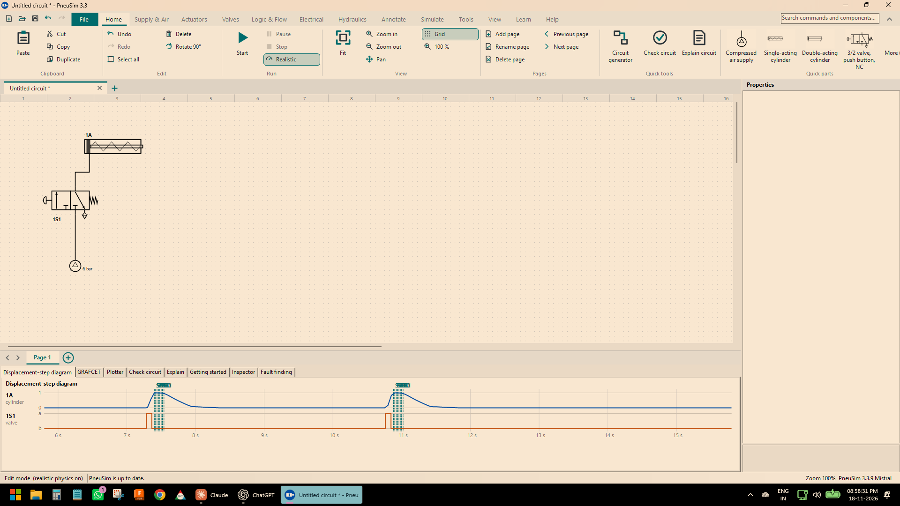
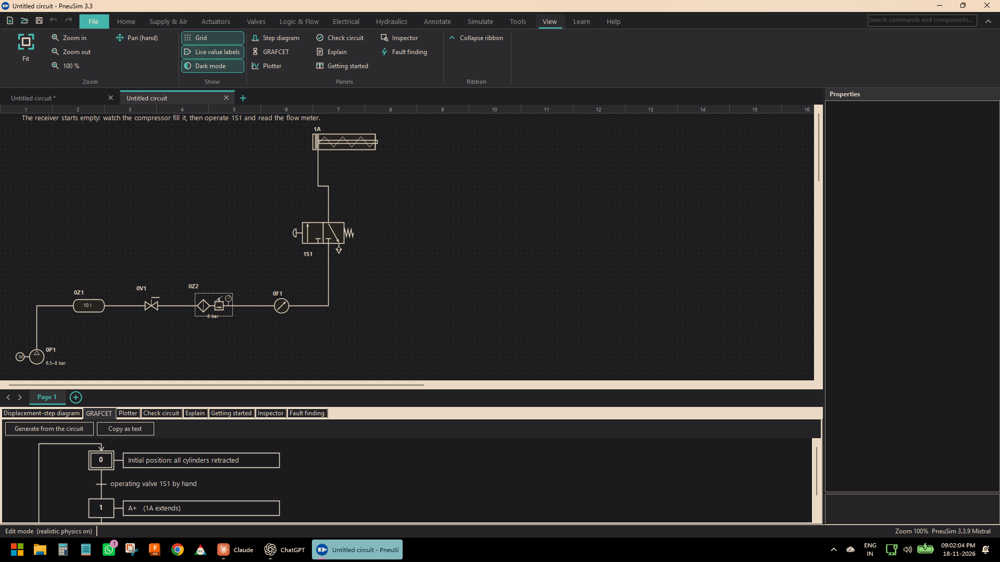

# PneuSim

**Design, simulate and check pneumatic, electro-pneumatic and hydraulic circuits on your Windows PC before you build anything.**

PneuSim 3.4 "Mistral" · © 2026 Akshaya Simha · akshsimha@gmail.com

## Contents
1. [Introduction](#1-introduction)
2. [Features](#2-features)
3. [System requirements](#3-system-requirements)
4. [Installation](#4-installation)
5. [Getting started](#5-getting-started)
6. [The screen, part by part](#6-the-screen-part-by-part)
7. [Tutorials](#7-tutorials)
8. [Settings](#8-settings)
9. [Keyboard shortcuts](#9-keyboard-shortcuts)
10. [Files](#10-files)
11. [Troubleshooting](#11-troubleshooting)
12. [Updates](#12-updates)
13. [Frequently asked questions](#13-frequently-asked-questions)
14. [Version history](#14-version-history)
15. [Credits and support](#15-credits-and-support)

---

## 1. Introduction

**What it is.** PneuSim is a Windows program in which you draw a circuit from components (air supply, valves, cylinders, switches, relays, pumps and more), press **Start**, and watch it work: tubes fill with pressure, cylinders move, solenoids switch, and the pressure, force and speed of every part can be read live.

**What it is for.**
- Checking that a circuit works before building it.
- Finding mistakes (unconnected ports, missing exhausts, signals that overlap) with a built-in check.
- Understanding a circuit: PneuSim explains it step by step in plain English.
- Producing documentation: PDF report with a title block and parts list, drawings in SVG/DXF/PNG, and a sequence chart (GRAFCET).
- Practising fault finding on circuits that contain hidden faults.

**Who it is for.** Engineers, technicians, designers and maintenance teams working with compressed-air or oil-hydraulic systems. You do not need to know any programming. Component names are plain English with the ISO name in brackets, for example *3/2 valve, push button, NC*. Symbols follow ISO 1219 / IEC 60617 drawing conventions.

## 2. Features

| Area | What you can do |
|---|---|
| **Draw** | Place components from the ribbon, connect port to port with tubes, hoses and wires, rotate, copy, paste, duplicate, undo and redo without limit. Several circuits open at once in file tabs; several pages per circuit in sheet tabs. |
| **Automatic tidiness** | Lines route themselves around components and keep off each other; where lines cross they hop over each other; a component dropped on top of another is moved to free space. |
| **Simulate** | Pneumatic, electro-pneumatic (24 V DC) and hydraulic circuits. *Realistic physics* adds pressure build-up, cylinder bore, load, friction and air consumption. Speeds from 0.1x to 4x. |
| **Look inside** | Live values (force, pressure, speed, flow) when you point at a part, optional value labels next to parts, a plotter with cursors and trigger, a displacement-step diagram, and replay (step back and forward in time). |
| **Cutaway** | Animated view inside a component (F7) or of the whole workspace at once (Shift+F7). |
| **Check and explain** | *Check circuit* finds mistakes; *Explain circuit* describes what happens when you operate it; GRAFCET chart generated from the circuit. |
| **Circuit generator** | Type a cylinder sequence such as `A+ B+ B- A-` and PneuSim draws the circuit. *Complete my circuit* adds valves, supply and tubes around components you already placed. |
| **Components** | Air supply, compressor, receiver, service unit, regulator, gauges, flow meter; single and double-acting, tandem, through-rod, telescopic cylinders; grippers, rotary actuators, DC and servo motors, electric cylinders; 2/2, 3/2, 4/2, 5/2, 5/3 valves; shuttle, two-pressure, check, quick-exhaust, flow-control, counterbalance valves; manifold; vacuum generator and suction cup; push buttons, switches, relays, timers, counters, sensors, lamps; hydraulic pump, tank, relief valve, accumulator, motors, 4/2 and 4/3 valves; text notes, page connectors, junctions. |
| **Tools** | Calculators (force, air use, tube size, and more), Sizing sheets (bore, tube, valve, pump, motor, accumulator), parts list with costs and yearly air cost, parameter sweep (compare cycle time, air use and speed). |
| **Safety** | Rated maximum pressure per component: a red frame, a message and an alarm sound if it is exceeded. |
| **Fault finding** | Put a fault into a circuit (leak, blocked, stuck, burnt coil, welded contact …) or let PneuSim hide one; find it by measuring. Hidden faults are stored encrypted. |
| **Output** | PDF report with print preview, SVG, DXF (CAD), PNG, parts list (CSV), animated GIF. |
| **Reliability** | Crash recovery autosave, safe saving with a `.bak` copy, clear messages for damaged files, a local error log (nothing is sent anywhere). |
| **Look** | Light, Dark, AMOLED (pure black) or follow Windows. Pressure in bar, MPa or kPa. Port names as numbers, letters (P, A, B, E, C, T) or both. |
| **Updates** | Update check at every start and optional silent automatic updates ([section 12](#12-updates)). |

## 3. System requirements

| | Minimum | Recommended |
|---|---|---|
| Windows | Windows 7 SP1 (64-bit or 32-bit) | Windows 10 or 11 |
| .NET | .NET Framework 4.7.2 (already part of Windows 10 version 1803 and later and Windows 11) | same |
| Processor | any dual-core | quad-core, 2 GHz or faster |
| Memory | 2 GB | 4 GB or more |
| Disk | 50 MB | 100 MB (for autosave and exports) |
| Screen | 1366 × 768 | 1920 × 1080 or larger |
| Internet | not needed to work | needed only for update checks |

Dark scroll bars need Windows 10 or later (on older Windows the scroll bars stay light).

## 4. Installation

1. Get `PneuSim-Setup-<version>.exe` from your supplier.
2. Double-click it. By default PneuSim installs **for your user only** and needs no administrator rights. (The installer offers an all-users installation if you have administrator rights.)
3. On the *Select Additional Tasks* page tick **Create a desktop shortcut** and **Open .pneu circuit files with PneuSim** if you want them.
4. Click **Install**, then **Finish**. If .NET Framework 4.7.2 is missing, the installer tells you and shows where to get it.
5. Start PneuSim from the Start menu or the desktop icon.

**Updating** an installed copy needs no uninstall: run the newer installer (or use Help > Update to new version). It upgrades in place and keeps your settings.
**Uninstalling:** Windows Settings > Apps > PneuSim > Uninstall. Your circuit files are never deleted.

## 5. Getting started

1. Start PneuSim. The **start screen** offers *New circuit*, *Open circuit…*, your recent circuits and the 13 built-in examples. You can also drag a `.pneu` file onto it.
2. For a first look, click example **1. Direct control of a single-acting cylinder**.
3. Press **Start** (F9). A push button is pressed for you automatically (see [Settings](#8-settings), *Operation*). Pressurised tubes turn blue, the cylinder moves.
4. Press **Stop** (F11), then **Explain circuit** (F8) to read how it works.

## 6. The screen, part by part

| Part | Purpose |
|---|---|
| **Quick-access buttons** (top left) | New, Open, Save, Undo, Redo. |
| **File** (green tab) | Opens the full-page *File view*: New (blank, generator, examples), Open and Recent, Save, Save As, Close, Export (PDF, SVG, DXF, PNG, parts list), Information (title block), Options (Settings), Exit. Click any other tab to leave it (or press Esc). |
| **Home tab** | Clipboard (Paste, Cut, Copy, Duplicate), Edit (Undo, Redo, Delete, Rotate 90°, Select all), Run (Start, Pause, Stop, Realistic), View (Fit, Zoom in/out, 100 %, Pan, Grid), Pages, Quick tools and Quick parts. |
| **Component tabs** | *Supply & Air, Actuators, Valves, Logic & Flow, Electrical, Hydraulics, Annotate*. Click a symbol, then click in the workspace to place it (hold Shift to place several, Esc to stop). Groups that are too long have a **More** button. |
| **Simulate tab** | Run (Start, Pause, Stop), Replay (step and event buttons), Speed, Options (Realistic physics, Record GIF, Automatic operation settings), Analyse (Check, Explain, GRAFCET, Step diagram). |
| **Tools tab** | Design (Circuit generator, Sizing sheets, Calculators), Documents (Parts list, Parameter sweep, PDF print preview), Check, Fault finding, Look inside (Cutaway), Settings. |
| **View tab** | Zoom, Pan, Grid, Live value labels, Dark mode, the bottom panels and *Bottom panel on/off*, *Collapse ribbon*. |
| **Learn tab** | Getting-started tutorials, Cutaway (F7), Cutaway of the whole workspace (Shift+F7), Examples, Quick Guide. |
| **Help tab** | Quick Guide (PDF, F1), Update to new version, About. |
| **Search box** (top right) | Type a word to find any command or component; Enter or click to run it. |
| **File tabs** | One tab per open circuit. **+** starts a new one, **×** (or middle-click) closes it. A star after the name means unsaved changes. |
| **Workspace** | The area where you place and connect components and where the simulation runs. Rulers at the top and left. |
| **Page tabs** (below the workspace) | Pages of one circuit, like sheets in a spreadsheet. **+** adds a page, right-click renames or deletes. Join pages with *page connectors* of the same name. |
| **Properties panel** (right) | Select a part to see and edit all its properties; hover for an explanation. Double-clicking a part never opens a window. |
| **Bottom tabs** | Displacement-step diagram, GRAFCET, Plotter, Check circuit, Explain, Getting started, Inspector, Fault finding. |
| **Status bar** | Mode, messages, update link, replay slider, zoom and version. |

Moving the view: mouse wheel scrolls, **Shift + wheel** or a two-finger sideways swipe scrolls sideways, **Pan** tool / middle mouse button / **Space + drag** moves the view. **Fit** shows the whole circuit.

Colours while simulating: pressurised air tubes blue, live wires red, oil lines orange; a red frame means a rated pressure is exceeded.

Optionally the **classic menu bar and toolbar** can be shown above the ribbon (Settings > Workspace; takes effect after restart).

## 7. Tutorials

### 7.1 Your first circuit: a cylinder that extends when you press a button
1. **Home > Quick parts** or the **Supply & Air** tab: click *Compressed air supply*, then click in the workspace.
2. **Actuators**: *Single-acting cylinder*, click above the supply.
3. **Valves**: *3/2 valve, push button, NC*, click between them.
4. Connect: drag from a small circle (**port**) on one part to a port on another. Supply port → valve port 1; valve port 2 → cylinder port. Lines route themselves.
5. Press **Start** (F9). PneuSim presses the button; the cylinder extends and returns.
6. **Check circuit** (F6) should report no problems. **Explain circuit** (F8) describes the sequence.

### 7.2 Let PneuSim draw a circuit for you
1. **Tools > Circuit generator** (Ctrl+G, or the *Circuit generator* button on the Home tab).
2. Choose *Make a circuit from a sequence*, type a sequence, for example `A+ B+ B- A-` (A+ = cylinder A extends, A- = retracts), choose electro-pneumatic or pneumatic, and confirm.
3. To keep cylinders you have already placed, tick *Build around the cylinders already in the workspace*.
4. If the Workspace already contains components, the generator offers **Complete my circuit from the components already in the workspace**: PneuSim adds the missing valves, supply and wiring and connects everything. You can undo it.

### 7.3 Find out why something does not move
1. Press **Check circuit** (F6): click a message to jump to the part.
2. Turn on **Realistic** to see pressure build-up and load.
3. Point at a part while running to read force, pressure, speed. Right-click a part or tube for the **Inspector** with sliders.
4. Use the **Plotter** bottom tab to graph values; drag the timeline slider (status bar) to replay.

### 7.4 Print a report
**File > Export > PDF report** (Ctrl+P): fill in the title block under **File > Information**, check the print preview, then *Save as PDF* or *Print*.

### 7.5 Practise fault finding
**Tools tab > Fault finding > New task** hides a fault. Measure with right-click, ask for a *Hint* (Ctrl+H), then choose *I found the fault…*.

## 8. Settings

Open with **Ctrl+,** or **Tools > Settings** (also File > Options). Click **OK** to keep changes, **Cancel** to discard.

**General**
| Setting | Effect |
|---|---|
| Theme | Follow Windows, Light, Dark or AMOLED (pure black). |
| Pressure unit | bar, MPa or kPa for labels, Properties and Inspector. |
| Currency symbol | Used for costs in the parts list and air cost. |
| Advanced mode | Shows engineering properties such as the rated maximum pressure. |
| Show the start screen when PneuSim starts | On/off. |
| Recovery copy every N minutes | Autosave interval, 0 = never. |
| Check for updates every time PneuSim starts | Looks for a new version at start. |
| Install new versions automatically | Downloads and installs updates by itself ([section 12](#12-updates)). |

**Simulation**
| Setting | Effect |
|---|---|
| Operation (Automatic one cycle / keep repeating / Manual) | PneuSim presses the start push button for you, or you do it. |
| Wait after Start; rest between cycles; hold a start button for | Timing of the automatic operation (0 = work it out). |
| Solenoid valves (Automatic / Manual) | PneuSim operates solenoids that have no coil in the circuit, or you click them (manual override). |
| Simulation speed at start-up | 0.1x to 4x. |
| Realistic physics on by default | Pressure build-up, loads, air use. |

**Workspace**
| Setting | Effect |
|---|---|
| Show live value labels / values when pointing | Values next to parts / in the tooltip. |
| Snap components to the grid; show grid dots | Placement aids. |
| Port names on components | Off, Numbers (1 2 3), Letters (P A B E C T) or Both. |
| Classic menu bar and toolbar | Shows them above the ribbon after restart. |

**Sounds:** master switch, volume and a switch for each sound (valve click, end-stop thud, exhaust hiss, compressor/pump hum, relief-valve chatter, alarm). Everything that makes a sound is also shown on screen.

Settings are stored in `%APPDATA%\PneuSim\settings.ini`.

## 9. Keyboard shortcuts

| Group | Keys | Action |
|---|---|---|
| **Files** | Ctrl+N / Ctrl+O / Ctrl+S | New / Open / Save |
| | Ctrl+W / Ctrl+Shift+W | Close circuit / close all |
| | Ctrl+P | PDF report (print preview) |
| **Edit** | Ctrl+Z / Ctrl+Y | Undo / Redo |
| | Ctrl+X / Ctrl+C / Ctrl+V | Cut / Copy / Paste |
| | Ctrl+D, Ctrl+A | Duplicate, Select all |
| | R, Del, arrow keys | Rotate, Delete, nudge selection |
| **Simulation** | F9 / F10 / F11 | Start / Pause / Stop and reset |
| | F12, Shift+F12 | Step forward / back in time |
| | Ctrl+F12, Ctrl+Shift+F12 | Forward / back to the next / previous event |
| **Tools** | Ctrl+G | Circuit generator |
| | F6 / F8 | Check circuit / Explain circuit |
| | Ctrl+H | Hint (fault finding) |
| | Ctrl+, | Settings |
| **View** | Ctrl++ / Ctrl+- | Zoom in / out |
| | Ctrl+0 / Ctrl+9 | 100 % / fit all |
| | Ctrl+' | Grid on/off |
| | Ctrl+F1 | Collapse / expand the ribbon |
| | Ctrl+PgDn / Ctrl+PgUp | Next / previous page |
| | Space + drag, middle mouse | Pan |
| | F7 / Shift+F7 | Cutaway of the part / of the whole workspace |
| **Help** | F1 | Quick Guide (PDF) |
| **Mouse** | Shift + click | Place several copies |
| | Esc | Stop placing; close the File view |
| | Drag port to port | Connect |
| | Drag a box | Select several parts |
| | Right-click while running | Live values (Inspector) |

## 10. Files

| Item | Detail |
|---|---|
| **Circuit file** | `.pneu` (XML text). One file holds all pages of a circuit. Details: [docs/FILE_FORMAT.md](docs/FILE_FORMAT.md). |
| **Open** | File > Open, Ctrl+O, drag a file onto the start screen, double-click a `.pneu` file (if you chose the association), or pick it from Recent. A file that is already open is simply shown. |
| **Save** | Ctrl+S. PneuSim writes and checks a temporary file, keeps your previous version as `<name>.bak`, then replaces the file. |
| **Export** | PDF report, SVG and DXF drawings (current page), PNG image, parts list CSV, plot CSV/PNG, animated GIF (Record GIF). |
| **Autosave** | Every minute (setting) to `%APPDATA%\PneuSim\autosave.pneu`; offered for restore after a crash. |
| **Examples** | 13 built-in examples (Examples list, File > New). |
| **Error log** | `%LOCALAPPDATA%\PneuSim\logs`. It stays on your computer. |

Files saved by a newer PneuSim version are refused with a clear message instead of being damaged.

## 11. Troubleshooting

| Problem | Likely cause | What to do |
|---|---|---|
| Nothing happens when I press Start | The circuit is not complete, or a valve needs operating | Press **Check circuit**; check Settings > Simulation > Operation (Manual means you press the buttons) |
| A cylinder does not move | No pressure at its port, exhaust blocked, load too high in Realistic mode | Point at the ports for pressures; read Check and Explain; try ideal mode (Realistic off) |
| A port will not connect | Different kinds (air to oil to wire) | Air, oil and electrical ports only connect to the same kind |
| Lines run oddly | Hand-dragged lines are kept as drawn | Select the part and press **R** twice, or drag the line again; automatic lines re-route on their own |
| A pressure value looks wrong | Unit setting | Settings > Pressure unit |
| PneuSim closed unexpectedly | — | Start it again; it offers to restore the autosave. The log is in `%LOCALAPPDATA%\PneuSim\logs` (use *Copy error report* in the error window) |
| "File is damaged" | Interrupted save or copy | Rename the `.bak` file next to it to end in `.pneu` |
| Update check fails | No internet, firewall | See [section 12](#12-updates); retry with Help > Update to new version |
| Windows scroll bars are light in Dark mode | Windows 7/8 | Not supported there; the rest of the theme works |
| The installer says .NET is missing | Old Windows | Install .NET Framework 4.7.2 from Microsoft, then run the installer again |

## 12. Updates

- **At every start**, when a network is connected, PneuSim asks the update server whether a newer version exists. If there is no network, nothing happens and no message appears.
- If a newer version exists you see a window with what is new and **Update now** / **Later**; an **Update available** link also stays at the bottom right of the window. **Help > Update to new version** checks on demand.
- **Update now** downloads the installer, **verifies its SHA-256 checksum** against the published one (a file that does not match is rejected and deleted), saves your work, closes PneuSim and upgrades it in place; your settings stay.
- **Automatic updates** (Settings > General > *Install new versions automatically*, off by default): PneuSim downloads and verifies a new version quietly in the background and installs it silently **when you close PneuSim** — never while you work. 
- Every update step is written to `%LOCALAPPDATA%\PneuSim\logs\update.log`. If an automatic installation does not finish, PneuSim notes it at the next start and offers the update again.
- Updates come only from the PneuSim release site over HTTPS. Switch off *Check for updates* in Settings to stop all update traffic. Nothing about your circuits or your computer is sent.
- If an update fails, the installed version stays as it is (the installer replaces files only when it can complete); run the installer manually from the release site if needed.

## 13. Frequently asked questions

**Do I need an internet connection?** No, only for update checks.
**Can I open circuits from older versions?** Yes. Files from a newer version are refused politely.
**Why does PneuSim press buttons for me?** *Automatic operation* (Settings > Simulation) so that a circuit runs as soon as you press Start. Choose *Manual* to do it yourself.
**What does Realistic mean?** Pressures build up over time, cylinders move according to bore, load and friction, and air use is measured. With it off, pressures switch instantly and cylinders take their set stroke time.
**What do the port letters mean?** P supply, A and B working ports, E exhaust (R/S in ISO 5599), C compressor, T tank. Numbers are the ISO 1219 numbers 1, 2, 3, 4, 5.
**Can I change the unit of pressure?** Yes: bar, MPa or kPa in Settings.
**How do I connect several tubes to one port?** Use a **junction** or the **manifold** (2 to 8 outlets). *Complete my circuit* adds a manifold by itself when a port would feed three or more tubes.
**Where are my settings and autosave?** `%APPDATA%\PneuSim\`.
**Is my data sent anywhere?** No. The only network use is the update check and download.
**Which standards do the symbols follow?** They are drawn by PneuSim based on ISO 1219 / IEC 60617 conventions. PneuSim does not claim certification.

## 14. Version history

The full list is in [CHANGELOG.md](CHANGELOG.md). Highlights:

| Version | Date | Highlights |
|---|---|---|
| 3.5.0 | 19 Nov 2026 | Units in Calculators and Sizing, automatic manifolds in Complete my circuit, update log and retry |
| 3.4.x | 18 Nov 2026 | Audit and stabilisation: update check at every start, automatic updates, many fixes (see [docs/AUDIT-3.4.md](docs/AUDIT-3.4.md)) |
| 3.3.9 – 3.3.18 | 18 Nov 2026 | Ribbon and File view, sheet tabs, auto-routing, crossover hops, manifold, air counterbalance valve, port names, print preview, search |
| 3.3.0 – 3.3.8 | 18 Nov 2026 | New look and ribbon, start screen, sounds, rated pressure, fault finding, new actuators, automatic operation, AMOLED theme, whole-workspace cutaway, GRAFCET, Sizing sheets, multi-circuit tabs, update system |
| 3.2.0 | 2026 | Last release of the first line (VB.NET origin) |

## 15. Credits and support

- Designed and developed by **Akshaya Simha**, © 2026.
- Support and licensing questions: **akshsimha@gmail.com**. When you write about a problem, include the PneuSim version (status bar, bottom right) and, if possible, the error report from the error window.
- Developer notes (source layout, build, tests): [docs/DEVELOPMENT.md](docs/DEVELOPMENT.md).
