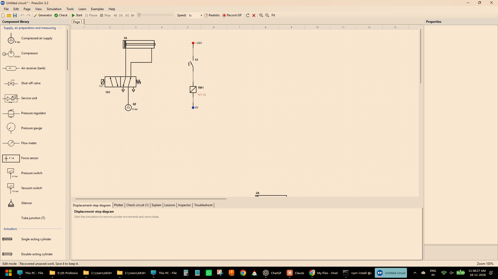

# PneuSim 3.2 – GUI reference

These screenshots were taken from the installed 3.2.0 on 18 Nov 2026, at 1920 × 1080 with the
light theme. They are the visual reference for the recovered source: after any change the
rebuilt program should look like this, unless the change is meant to alter the look. Originals
are in `docs/screenshots/` (the user's copies are in
`OneDrive\SOFTWARE DEVELOPMENT\# Programmed\Windows based\PneuSim-Setup`).

## 1. Main window layout



```
┌ Title: "<file name> [*] - PneuSim 3.2" ───────────────────────────────────────────────────┐
│ Menu: File Edit Page View Simulation Tools Learn Examples Help                            │
│ Toolbar: New Open Save | Undo Redo | Generator Check | Start Pause Stop | replay ◀◀ ◀ ▶ ▶▶ │
│          + time slider | Speed [0.1x 0.25x 0.5x 1x 2x 4x] | Realistic  Record GIF |       │
│          Rotate Delete | Zoom in Zoom out Fit                                             │
├───────────────┬──────────────────────────────────────────────────────┬────────────────────┤
│ Component     │ Page tabs (Page 1 …)                                 │ Properties         │
│ library       │ column numbers 1 … 14 along the top                  │ (grouped grid +    │
│ (grouped,     │ drawing sheet (dotted grid)                          │  help text for the │
│  scrolling)   ├──────────────────────────────────────────────────────┤  selected setting) │
│               │ Bottom tabs: Displacement-step diagram | Plotter |   │                    │
│               │ Check circuit (n) | Explain | Lessons | Inspector |  │                    │
│               │ Troubleshoot                                         │                    │
├───────────────┴──────────────────────────────────────────────────────┴────────────────────┤
│ Status: mode ("Edit mode") | message | Zoom 100%                                           │
└────────────────────────────────────────────────────────────────────────────────────────────┘
```

Code: `UI/MainForm.cs` (`BuildMenu`, toolbar from about line 2540, replay bar about line 1840,
status bar about line 2268), `UI/CircuitCanvas.cs`, `UI/Library.cs`.

## 2. Screenshot index

| # | Screen | Code |
|---|---|---|
| 126 | Start-up prompt: "PneuSim was not closed normally last time. Restore the unsaved work from …?" | `MainForm` autosave recovery |
| 127 | Main window, *Displacement-step diagram* tab | `DiagramPanel` |
| 128 | *Plotter* tab: time window, Hold, Clear cursors, Export CSV/PNG, Trigger (channel, rising or falling, level "at", Single, Arm) | `PlotterPanel` |
| 129 | *Check circuit (1)* tab: Run full check (with a test run), "Fix: redesign (cascade)", "Fix: redesign (electro-pneumatic)", problem list | `CircuitAnalysis`, `MainForm` |
| 130 | *Explain* tab: "Operate:" picker + Explain my circuit | `CircuitAnalysis.Explain` |
| 131 | *Lessons* tab: lesson list, task text, Load starting parts, Check my solution, Hint | `LessonsPanel`, `Lessons` |
| 132 | *Inspector* tab: State inspector (Quantity / Value) | `InspectorPanel` |
| 133 | *Troubleshoot* tab: New exercise, Hint, I found it…, Show fault, Report…, Add fault…, Repair all | `TroubleshootPanel` |
| 134–140 | Component library, scrolled from top to bottom | `Library` |
| 141–149 | Menus: Help, Examples, Learn, Tools, Simulation, View, Page, Edit, File | `MainForm.BuildMenu` |
| 150 | Properties of a single-acting cylinder (Cylinder / General / Physical data (realistic mode) / Position marks) | `CylinderBase`, `ElementDescriptionProvider` |
| 151 | Properties of a 5/2 valve (Actuation: operated by, return, solenoid label) | `DirectionalValve` |
| 152 | Properties of a push button (Contact: normally closed, operated by) | `ElectricContact` |
| 153 | Properties of a valve solenoid coil (Coil: type) | `ElectricCoil` |
| 154–165 | Examples 1–12, freshly loaded ("Example loaded. Press Start (F9) …") | `Examples` |

## 3. Library groups (as shown)

Supply, air preparation and measuring → Actuators → Directional control valves → Solenoid
valves → Logic, non-return and flow valves → Electrical (24 V DC) → Hydraulics → Drawing.
Each entry shows its ISO symbol with the name beside it. Long names wrap onto two lines.

## 4. Menu shortcuts seen in the screenshots

| Menu | Shortcuts |
|---|---|
| File | New Ctrl+N, Open Ctrl+O, Save Ctrl+S |
| Edit | Undo Ctrl+Z, Redo Ctrl+Y, Cut Ctrl+X, Copy Ctrl+C, Paste Ctrl+V, Duplicate Ctrl+D, Select All Ctrl+A, Delete Del, Rotate 90° R |
| Page | Next page Ctrl+PgDn, Previous page Ctrl+PgUp |
| View | Zoom In Ctrl++, Zoom Out Ctrl+-, Actual Size Ctrl+0, Zoom to Fit Ctrl+9, Cutaway view F7 |
| Simulation | Start F9, Pause F10, Stop and Reset F11, Step back Shift+F12, Step forward F12, previous event Ctrl+Shift+F12, next event Ctrl+F12 |
| Tools | Circuit Generator Ctrl+G, Check my circuit F6, Explain my circuit F8; Troubleshooting ▸ submenu |
| Help | Quick Guide F1 |

The menus in the screenshots match the menus built in the recovered `MainForm.cs`.

## 5. UI issues seen in the screenshots (revision backlog)

| # | Issue | Screenshot | Likely place to fix |
|---|---|---|---|
| G1 | The Properties label column is too narrow, so names are cut off ("End-position c…", "Moving load (k…", "Rod diameter (…", "Normally close…", "Return / right s…") | 150–153 | `MainForm` property grid: set the label column width or use shorter display names |
| G2 | The canvas's horizontal scrollbar sits short and partly hidden above the bottom panel, and parts near the splitter are cut (cylinder 2A) | 127–133 | `MainForm` layout: splitter and canvas docking |
| G3 | The restored autosave contains a stray cylinder 2A far below the visible circuit. The checker reports it, but nothing leads the user to it (e.g. clicking the problem to select and zoom to it) | 129 | `MainForm` Check tab, `CircuitCanvas` |
| G4 | Text and icons are small at 1920 × 1080 / 100 % (library, tabs, properties). Check DPI awareness and font scaling | all | `Program.cs` / app manifest (DPI awareness), `Theme` fonts |
| G5 | The library is a single long scrolling list (about 100 entries) with no search box and no collapsible groups | 134–140 | `Library` |
| G6 | The Properties panel is empty when nothing is selected. It could show the page or project settings instead | 127–149 | `MainForm` |

These were judged from the screenshots only. Each one should be confirmed in the running
program before it is fixed.
